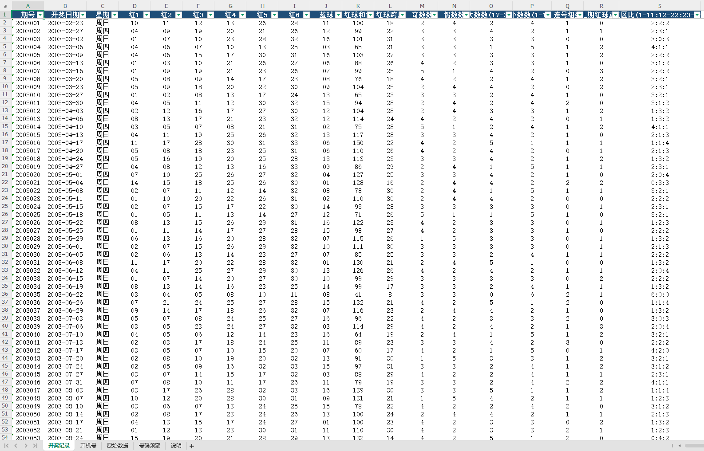

# SSQ History Data Tool

[中文版](README.md)

A small Python utility for downloading, normalizing and exporting publicly displayed Chinese Double Color Ball (双色球 / SSQ) historical drawing records. It produces Excel, CSV and TXT files for convenient filtering and descriptive analysis. **It does not forecast numbers, generate picks, or offer betting strategies.**



## Features

- Retrieves historical records from a third-party public page. Uses HTTP requests first and optional Selenium browser automation as fallback.
- Sorts each red-ball set in ascending numerical order, then exports six separate red columns and one blue column. The source's original text is retained in a separate sheet.
- Adds red-ball sum, span, odd/even and high/low counts, consecutive-run counts, overlap with previous drawing, and regional distribution.
- Generates descriptive frequencies for the entire history and trailing windows of 100, 50 and 30 draws.
- Separates site-provided *simulated startup numbers* from the official drawing results.
- Exports `.xlsx`, `.csv`, and `.txt`, with basic integrity checks and troubleshooting logs.

## Windows quick start

1. Install Python 3 (Python 3.12 recommended) and confirm `py -3 --version` works.
2. Download this repository ZIP and **extract all files** into one directory.
3. Double-click `run.bat`. It checks/install dependencies and writes files to `双色球数据/`.
4. Open `双色球数据/双色球历史数据.xlsx` in Excel.

Command-line alternative:

```powershell
py -3 -m pip install -r requirements.txt
py -3 ssq_downloader.py
```

For installation errors and diagnostic logs, see the [Chinese troubleshooting guide](docs/TROUBLESHOOTING.md). Unit tests: `python -m pip install pytest && python -m pytest -q`.

## Data and license

The current page is https://www.17500.cn/chart/ssq-kjh.html. This independent project is **not affiliated** with any lottery authority or the source website. Please verify drawn results using official notices. Third-party simulated startup numbers are not official drawn results. Data-site terms and access restrictions apply; MIT applies to **project source code only**, not third-party content.
