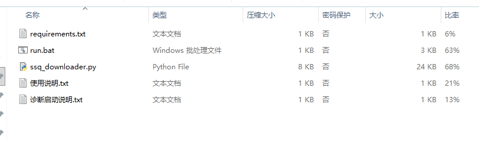

# Windows 安装、历史排错记录及故障排除

## 最简安装流程

1. 安装 Python 3（建议 3.12），确认 `py -3 --version` 有返回。
2. GitHub 下载 ZIP 并**完整解压**到新文件夹，例如 `D:\ssq-history-data-tool`。
3. 确保 `run.bat`、`ssq_downloader.py`、`requirements.txt` 位于**同一层目录**。
4. 双击 `run.bat`；运行完在 `双色球数据/` 中打开 `双色球历史数据.xlsx`。
5. 如失败，检查 `双色球数据/启动诊断日志.txt` 和 `双色球数据/运行日志.txt`。

## 曾经真实遇到的问题（2026 年 10 月的一次 Windows 安装）

### 1. 依赖都安装正确，却提示找不到 Python 源文件

**实际现象**：当时 Windows 已安装 Python 3.12，`py -3` 能启动，`requests`、`bs4`、`openpyxl`、`selenium` 的导入检查全部通过；但启动后报类似错误：

```text
python: can't open file '.../ssq_downloader_new.py': [Errno 2] No such file or directory
```

**根因**：旧 `run.bat` 引用了 `ssq_downloader_new.py`，而实际文件为 `ssq_downloader.py`。这与 Python 安装失败无关。

**修复**：统一文件名，启动脚本只调用 `ssq_downloader.py`。请勿将不同压缩包版本的 `.bat` 与 `.py` 混在一起。

### 2. 双击窗口瞬间关闭，看不到报错

**实际现象**：双击后命令窗口关闭，无法判断哪里出错。

**修复**：现在 `run.bat` 记录 `启动诊断日志.txt`，运行结束使用 `pause` 留住窗口。也可以从 CMD 中手动调用：

```bat
cd /d "D:\ssq-history-data-tool"
run.bat
```

路径应替换为**你自己**的项目实际路径，不能直接照抄他人的用户名或桌面目录。

### 3. 确认 Python 解释器与依赖确实匹配

当时有效的检查命令是：

```powershell
py -3 --version
py -3 -c "import requests,bs4,openpyxl,selenium; print('依赖检查 OK')"
```

如果本机上述命令通过，通常不必重装 Python，应先查启动脚本路径和文件名。

> 以上是有记录的真实问题。不能据此断言每个用户的故障都相同，也不能断言历史成功下载具体经过了 HTTP 或浏览器哪条途径。

## 其他可能的故障（通用排错，不代表历史上都发生过）

| 现象 | 可能原因 | 建议处理 |
| --- | --- | --- |
| `py` 不是内部或外部命令 | Python Launcher 未安装 / PATH 配置差异 | 试 `python --version`；重装 Python 时勾选 Launcher，或使用解释器完整路径 |
| `No module named ...` | 依赖装到了别的 Python 环境 | `py -3 -m pip install -r requirements.txt`；避免单独调用不确定环境的 `pip` |
| `No module named pip` | Python 缺少 pip | 尝试 `py -3 -m ensurepip --upgrade`，之后重装依赖 |
| 依赖安装超时 / SSL 报错 | 网络、代理或证书环境 | 检查访问 PyPI 的网络和代理配置；保留终端原始错误再排查 |
| Edge / Chrome 无法启动 | 浏览器未安装、驱动获取失败或浏览器环境受限 | 先检查 HTTP 直连是否成功，再查看 Selenium 报错；必要时更新 Edge / Chrome 与 Selenium |
| 网页只返回几十或几百期 | 数据源页面默认仅展示短列表，或结构改动 | 程序会尝试切换长列表，未达到3000期会拒绝当作完整历史；检查网站是否改版 |
| Excel 打开提示文件被占用 | 上次生成的 Excel 文件仍在编辑 | 关闭 Excel 后重试，或将已有文件另存副本 |
| Excel 中文乱码（CSV） | 软件使用错误的编码打开 CSV | 首选 `.xlsx`；CSV 以 UTF-8 BOM 编码导出，按 UTF-8 导入 |
| `ssq_downloader.py` 不存在 | 只解压部分文件或混用旧包 | 使用 GitHub 最新压缩包，完整解压全部文件 |
| 日志未生成 | 解释器未成功进入主程序 | 先查看 `启动诊断日志.txt`；从 CMD 运行以读取首个错误 |

## 说明：没有图形界面

本项目是**命令行下载整理程序**，不是 Windows 桌面 GUI。截图是生成后的 Excel 表格：


最初打包时的文件内容截图（仅供对照；GitHub 发布版文件略有增加）：



## 报错反馈建议附带的信息

- Windows 版本、`py -3 --version` 的返回内容；
- 完整解压目录中的文件列表；
- `双色球数据/启动诊断日志.txt` 和 `双色球数据/运行日志.txt`；
- 页面当前显示的最新期号（如能打开）。

提交公开 Issue 前，请先检查日志中是否包含本机用户名、绝对路径、代理地址、令牌等敏感内容，必要时打码。
